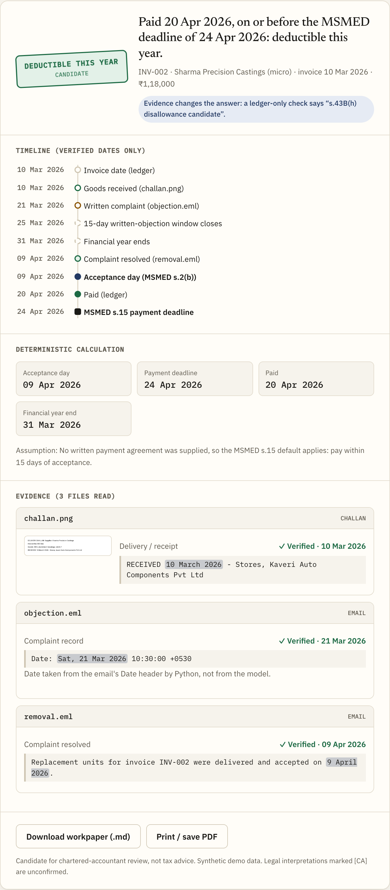

# AcceptGuard

**Evidence-backed MSME payment deadlines for s.43B(h) review.** Gemini reads the delivery challans, emails, letters and contracts behind an invoice; Python checks every quoted date against the source and computes the statutory deadline; an accountant decides.

> **Read this first.** AcceptGuard is a decision-support and evidence-review prototype, not tax advice. Every evaluation number below comes from **synthetic, author-generated documents** (photographs are simulated). It does not establish real-world legal or accounting accuracy. A chartered accountant must review every output.



Built for Google Cloud Gen AI Academy APAC, *Meet the Builders 2026*. Live demo: **[acceptguard.onrender.com](https://acceptguard.onrender.com)** (free tier; the first request after idle can take about a minute to wake). Demo video: *link added at submission*.

## The problem

From FY 2023-24, s.43B(h) of the Income-tax Act, 1961 (s.37(2)(g) of the Income-tax Act, 2025 from tax year 2026-27) allows a deduction for a payment owed to a **micro or small enterprise** in the year it accrues only if it is paid within the time limit in s.15 of the MSMED Act, 2006. Otherwise the deduction moves to the year of payment.

That time limit does not run from the invoice date. Under MSMED s.2(b) and s.15 it runs from the **day of acceptance**:

- Acceptance is the day goods are actually delivered, unless the buyer **objects in writing within 15 days**. Then it is the day the supplier removes the objection.
- With no written agreement, pay within 15 days of acceptance. A written agreement may allow more, but never more than **45 days from acceptance**.

An accounts-payable ledger has the invoice date and the payment date. It does not have the receipt stamp, the rejection email, the replacement delivery, or the contract clause. Finance teams and their auditors reconstruct those by hand, document by document. AcceptGuard does that reconstruction and shows its work, so the reviewer checks evidence instead of hunting for it.

**Intended users:** accounts-payable teams and chartered accountants preparing tax audit (Form 3CD) and year-end s.43B(h) workings for buyers of micro and small enterprises.

## How it works

```mermaid
flowchart LR
  U[Evidence files<br/>challan, email, letter,<br/>contract, photo] --> G[Gemini 3.5 Flash-Lite<br/>structured extraction<br/>date as written + ISO + quote]
  U --> T[Tesseract OCR<br/>independent text<br/>for images and scans]
  G --> V{Python verification}
  T --> V
  V -->|every check passes| C[Deterministic MSMED clock<br/>acceptance day, deadline,<br/>s.43B(h) outcome]
  V -->|any check fails, conflict,<br/>dropped fact, amendment| R[Abstain:<br/>route to accountant<br/>with the reason]
  C --> W[Workpaper: verdict, verified timeline,<br/>exact quotes, assumptions]
  R --> W
  W --> CA[Chartered accountant<br/>reviews and signs off]
```

| Layer | Does | Never does |
|---|---|---|
| **Gemini multimodal extraction** (`extract.py`) | One structured-output call per document returns each relevant date exactly as written, its ISO value, and the sentence it came from: delivery, complaint raised/recorded/resolved, complaint medium, credit terms, invoice reference. Reads PDFs, images and email text directly. | Decide whether a complaint is valid, compute acceptance, or report confidence. The schema has no field for them. |
| **Tesseract independent verification** (`ingest.py`, `verify.py`) | OCRs images and scanned PDFs separately from Gemini. The exact date token must appear in the OCR text (digits are never fuzzy-matched). | Trust the model's reading of an image on its own. |
| **Python deterministic logic** (`verify.py`, `dates.py`, `decide.py`, `clock.py`) | Quotes must exist in the source on word boundaries; dates are re-parsed with no guessing (DD/MM ambiguity, missing years and impossible dates abstain); email dates come from the `Date` header, not the model; documents must agree; then MSMED and s.43B(h) rules compute the outcome. | Call a model, or turn a failed check into a guess. |
| **Accountant review** | Receives a workpaper with the verdict, every date it rests on, each source quote, the assumptions, and the reason for any abstention. Contested interpretations are labelled `[CA]` in [`interpretations.py`](src/acceptguard/interpretations.py). | Get replaced. Every output is worded as a candidate for review. |

### Safety and abstention design

AcceptGuard is built to say "I don't know" rather than be wrong. It abstains, with a plain-English reason, when:

- a quote or date is not in the source, a date is ambiguous or yearless, or OCR cannot confirm an image's date;
- documents disagree on delivery, resolution or credit terms, or a document is filed under the wrong invoice;
- **an uploaded file yields no facts at all** (a dropped fact is invisible to verification; added after held-out failure 1);
- **a document shows an amendment and more than one date**, so which entry stands is a judgment call (added after held-out failure 2);
- a written objection has no resolution, the ledger claims credit days without a contract and the answer depends on it, the vendor is a trader (unsettled law), or Gemini is unavailable.

**Prompt injection.** Uploaded text is sent only as document content, never as instructions; the system prompt tells the model to report facts only; output must match a strict schema; and any value it reports must be found in the source and re-derived by Python. Five injection documents in the held-out sets (challan, email, contract, delivery note, email postscript) were resisted in every run. Injection resistance is not guaranteed: an injected date that is also written in the document could pass verification if the model chose it.

## Evaluation

Full method and per-case tables: [`docs/EVALUATION.md`](docs/EVALUATION.md) and [`docs/EVALUATION_TABLES.md`](docs/EVALUATION_TABLES.md). Raw results: [`eval/results/`](eval/results/). Every model call was a real Gemini 3.5 Flash-Lite request and every image check used real Tesseract 5.5.4. The extraction prompt was frozen (`extract_v2.md`, sha256 `2d9043fdffc0`) before any held-out run and never changed.

Headline metric: **wrong computed conclusions** (computed and wrong). Abstaining is safe; computing wrongly is not.

| Set | What it is | Wrong computed | Computed correct | Required abstentions met | Unnecessary abstentions |
|---|---|---|---|---|---|
| Dev | 16 invoices; prompt developed here | 0 | 9/9 | 6/6 | 1 |
| Held-out 1, original code | 22 invoices, 3 uncached runs | **1 · 1 · 1** (gate failed) | 8/9 · 7/8 · 7/8 | 8/9 · 9/9 · 9/9 | 5 · 5 · 5 |
| Held-out 2, untouched, after fixes | 17 invoices, 3 uncached runs | **0 · 0 · 0** | 8/8 · 8/8 · 8/8 | 2/2 · 2/2 · 2/2 | 7 · 7 · 7 |

**The release gate failed twice on held-out set 1 and both failures are preserved** in the git history and results:

1. *KSF-0093:* Gemini returned nothing for an ERP inward-register export, so a delivery-date conflict vanished and the remaining email produced a confident answer. Fix: a file that yields no facts routes to review.
2. *DP-0419:* a receipt note showed the original date and an initialled correction; Gemini cited the original. Both quotes really are in the document, so verification passed. Fix: amended records with several dates route to review.

Both fixes were then evaluated on **held-out set 2**, written after the fixes and run only once the set was committed. It produced no wrong computed conclusions in three uncached runs, at a high cost: 7 of 17 invoices abstained unnecessarily (replacement deliveries mistaken for first deliveries, a repair date the model ignored, an OCR misread of a simulated photo, and the two new rules' own costs). Cost was about $0.03 per 31-document run; median latency was about 2 s per document.

**What this does not show.** Small n, synthetic data written by the author (and by Claude, a different model from the system under test), clean renders, simulated rather than real photographs, and labels decided by one person. Zero observed errors on 24 computed answers is not evidence of production safety. The legal rules have not been reviewed by a chartered accountant.

## Run it locally

Requirements: Python 3.13, [uv](https://docs.astral.sh/uv/), Tesseract (`brew install tesseract` or `apt install tesseract-ocr`), and a Gemini API key from [Google AI Studio](https://aistudio.google.com/apikey).

```bash
git clone https://github.com/shro-2002/acceptguard.git && cd acceptguard
uv sync
cp .env.example .env   # then put your key in .env: GEMINI_API_KEY=...
PYTHONPATH=src uv run --env-file .env uvicorn acceptguard.web.app:app --port 8800
```

Open http://localhost:8800 and pick a sample case, or upload your own (synthetic or redacted) documents.

Command line, for a whole ledger:

```bash
PYTHONPATH=src uv run --env-file .env acceptguard eval/data/dev/ledger.csv eval/data/dev/evidence --fy-end 2026-03-31 --as-of 2026-10-01
```

### Tests and evaluation

```bash
uv run pytest                     # 135 tests, no API key needed
PYTHONPATH=src uv run --env-file .env python eval/score.py eval/data/holdout2 --ocr tesseract --cache-dir .cache/fresh --tag mine
PYTHONPATH=src uv run python eval/report.py   # rebuild docs/EVALUATION_TABLES.md
```

Browser journeys (Playwright; start the app first, optionally a second copy on port 8801 with an invalid key to exercise the provider-outage path):

```bash
cd tools && npm install && node e2e/journeys.js http://127.0.0.1:8800 ../docs/screenshots http://127.0.0.1:8801
```

| Variable | Required | Purpose |
|---|---|---|
| `GEMINI_API_KEY` | yes | Server-side Gemini calls. Never sent to the browser. |
| `PORT` | no | Port in Docker/Render (default 8000). |

## Deploy

The repository includes a `Dockerfile` (Python 3.13 slim + Tesseract) and a `render.yaml`. On [Render](https://render.com): New → Web Service → this repo → runtime Docker → add `GEMINI_API_KEY` as a secret → deploy. Health check: `GET /health`. Any container host works the same way (Cloud Run: `gcloud run deploy --source . --set-secrets GEMINI_API_KEY=...`).

Production safeguards in the web app: Gemini is called server-side only; uploads go to a per-request temporary directory with a per-request cache and are deleted after the response, so no document content is stored; file type, size (8 MB, 6 files), magic bytes and names are validated and renamed server-side; per-client rate limit and bounded concurrency; provider errors are classified, never echoed raw; strict Content-Security-Policy; no document text in logs.

## Project layout

```
src/acceptguard/
  extract.py          Gemini call, schema, cache, retries
  ingest.py           ledger, email/PDF/image text, Tesseract
  verify.py           quote, OCR, date and amendment checks
  dates.py            explicit date parser, email Date header
  decide.py, clock.py MSMED acceptance, deadline, s.43B(h) outcome
  interpretations.py  every legal interpretation, tagged [CA]
  pipeline.py         one code path for CLI, web and evaluation
  web/                FastAPI app, explanations, static UI
eval/                 dev and held-out sets, generators, scorer, results
tests/                135 tests
tools/                Playwright journeys and demo-video scripts
```

## Technology

Google Gemini 3.5 Flash-Lite (`google-genai`, structured output with a Pydantic schema) · Tesseract 5 · Python 3.13 · Pydantic · FastAPI · vanilla HTML/CSS/JS · Playwright (end-to-end journeys) · Docker · Render.

## License

MIT. See [LICENSE](LICENSE).
